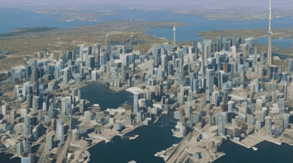
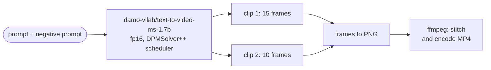

# Text-to-Video with Hugging Face Diffusers

**Generating a short video of the Toronto skyline from a text prompt with ModelScope's 1.7B text-to-video diffusion model, on a free Colab GPU, and what it took to get a usable clip.**

[](https://colab.research.google.com/github/dojedaro/diffusers-text-to-video/blob/main/LLM_GEN_AI_text_to_video.ipynb)
[](https://github.com/dojedaro/diffusers-text-to-video/actions/workflows/notebooks.yml)



*Five seconds (25 frames at 5 fps), stitched from two generated clips. Full quality:
[`Canada_Downtown_Toronto.mp4`](Canada_Downtown_Toronto.mp4).*

## Results: four attempts

The notebook keeps every attempt, which shows the trade-offs better than the final clip alone:

| Attempt | Prompt | Settings | What changed |
|---|---|---|---|
| 1 | "A lakeshore view of Downtown Toronto Canada with city skyline reflected in Lake Ontario" | 30 steps | Baseline |
| 2 | Detailed: CN Tower centered, skyscrapers reflecting in blue water | 40 steps, CPU offload + VAE slicing | More steps, and memory savers to fit the free GPU |
| 3 | "A cartoon style skyline of Toronto with the CN Tower clearly visible…" | 25 steps, 40 frames, 256×256 | A simpler style at lower resolution |
| 4 (shown) | "A cinematic aerial view of Toronto skyline with CN Tower…", plus a negative prompt | Two clips at 576×320, 30 steps: 15 skyline frames + 10 frames with a Canadian flag | The scene split into two prompts, generated separately and stitched |

Splitting the video into separate shots, each with its own prompt, and stitching them with ffmpeg gave
more control over what appears when than one long prompt.

## How it works



- **Model:** ModelScope's text-to-video (1.7B parameters), a 3D UNet that denoises a latent video,
  loaded in fp16.
- **Scheduler:** `DPMSolverMultistepScheduler`, which gets good samples in 25–40 steps instead of the
  default 50.
- **Memory:** `enable_model_cpu_offload()` and `enable_vae_slicing()` keep peak VRAM within a free
  Colab GPU.

## Run it

Needs a CUDA GPU; Colab's free T4 works.

```bash
pip install -r requirements.txt     # diffusers, transformers, accelerate, imageio[ffmpeg]
jupyter notebook LLM_GEN_AI_text_to_video.ipynb
```

The model weights download from the Hugging Face Hub on first run.

## Stack

Python, PyTorch, Hugging Face Diffusers, Transformers, Accelerate, ffmpeg.

## Limitations and next steps

- ModelScope 1.7B is an early open text-to-video model; newer open models produce longer, sharper and
  more consistent clips at higher resolution.
- No quantitative quality measure. A prompt-adherence score (CLIP similarity between frames and the
  prompt) would turn the attempts above into a comparison.
- Fixed seeds per attempt, so each change in the table is the only thing that changed.

## License

MIT
